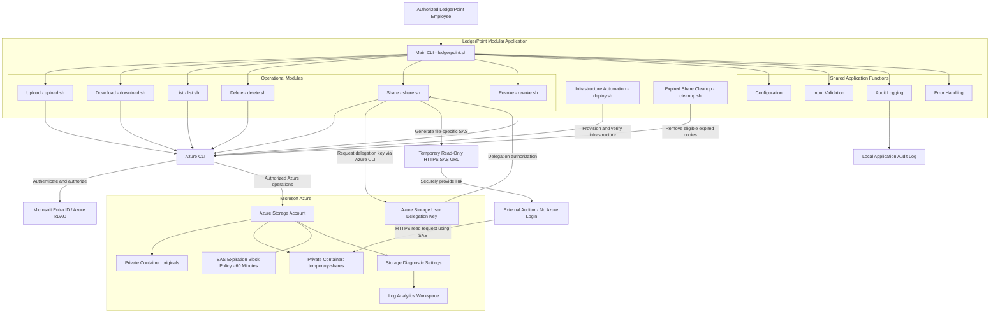
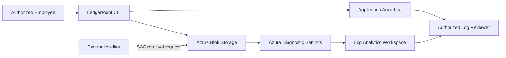

# LedgerPoint — Secure Cloud File Storage Architecture

**Project:** TECHCRUSH Group 2 — Secure Cloud File Storage System

**Cloud Provider:** Microsoft Azure

**Architecture Type:** Modular Cloud-Integrated Bash CLI

**Architecture Status:** Core implementation completed and regression tested; final acceptance verification pending.

**Last Updated:** November 25, 2026

## 1. Architecture Overview

LedgerPoint requires a secure, affordable cloud file storage system that allows authorized employees to manage financial statements and share individual documents with external auditors without requiring auditor accounts.

The solution uses Azure Blob Storage, Microsoft Entra ID, Azure RBAC, Bash, Azure CLI, User Delegation SAS URLs, Azure Monitor, Log Analytics, and application audit logging.

The application implements a modular architecture that separates its six primary operational functions into dedicated modules while maintaining a unified command-line interface.

The main application, `scripts/ledgerpoint.sh`, acts as the command dispatcher and manages shared configuration, validation, error handling, and application audit logging.

### 1.1 Modular Application Design

The six operational modules are:

- Upload module.
- Download module.
- List module.
- Delete module.
- Share module.
- Revoke module.

Each module has a clearly defined responsibility and is maintained in its own directory.

The main application loads these modules using Bash sourcing, allowing the operational functions to share configuration, validation, and audit logging mechanisms.

### 1.2 Application Structure

```text
scripts/
├── ledgerpoint.sh
├── deploy.sh
├── cleanup.sh
└── modules/
    ├── upload/
    │   └── upload.sh
    ├── download/
    │   └── download.sh
    ├── list/
    │   └── list.sh
    ├── delete/
    │   └── delete.sh
    ├── share/
    │   └── share.sh
    └── revoke/
        └── revoke.sh
```

### 1.3 Architectural Benefits

The modular design provides:

- Separation of concerns.
- Improved code readability.
- Improved application maintainability.
- Clearly defined operational responsibilities.
- Easier troubleshooting and debugging.
- Improved collaboration between group members.
- Reduced likelihood of Git merge conflicts.
- Simplified development of individual modules.
- Simplified functional and regression testing.
- Preservation of existing security controls.
- Preservation of the original command-line interface.
- A foundation for future architectural expansion.

The operational modules are separated at the source-code level but execute within the same Bash application process.

Therefore, LedgerPoint implements a modular application architecture rather than independently deployed microservices.

## 2. Architecture Diagram



The architecture separates internal employee operations from external auditor access.

Employees interact with the application through the unified Bash CLI, while external auditors access their authorized temporary documents directly through Azure Blob Storage using SAS URLs.

Auditors do not require access to the internal application, employee credentials, or Azure accounts.

## 3. Component Responsibilities

### 3.1 Application Components

| Component | Responsibility |
|---|---|
| Authorized employee | Manages confidential documents through the Bash CLI |
| Main CLI - ledgerpoint.sh | Dispatches commands, loads operational modules, and manages shared application functions |
| Upload module - upload.sh | Uploads documents into the originals container |
| Download module - download.sh | Downloads authorized documents from the originals container |
| List module - list.sh | Lists documents within supported containers |
| Delete module - delete.sh | Deletes original documents following explicit confirmation |
| Share module - share.sh | Creates temporary auditor copies and generates secure SAS URLs |
| Revoke module - revoke.sh | Revokes individual auditor access by deleting the corresponding temporary copy |
| Deployment script - deploy.sh | Creates or reuses Azure resources and verifies security configuration |
| Cleanup script - cleanup.sh | Identifies and removes eligible expired temporary copies |
| Shared configuration | Provides application-wide environment settings |
| Input validation | Validates document names, arguments, and sharing durations |
| Error handling | Reports application errors and failed operations |
| Application audit logging | Records application operations and their outcomes |

### 3.2 Azure Components

| Component | Responsibility |
|---|---|
| Azure CLI | Executes authorized Azure management and Blob Storage operations |
| Microsoft Entra ID | Authenticates employee identities |
| Azure RBAC | Provides role-based authorization for Azure operations |
| Azure Storage Account | Hosts private Blob containers |
| originals container | Preserves original confidential documents |
| temporary-shares container | Holds individually created temporary copies intended for external sharing |
| User Delegation Key | Supports SAS generation using Microsoft Entra authorization |
| User Delegation SAS | Provides temporary, read-only authorization to a specific shared Blob |
| SAS Expiration Policy | Blocks requests using SAS tokens that violate the configured validity interval |
| External auditor | Retrieves the permitted document without requiring an Azure account |
| Azure diagnostics | Records supported Blob Storage operations and request outcomes |
| Azure Monitor | Supports cloud resource monitoring |
| Log Analytics | Stores and supports investigation of Azure diagnostic events |

### 3.3 Automated Testing Components

| Test Script | Responsibility |
|---|---|
| tests/test-storage.sh | Verifies document storage operations and content integrity |
| tests/test-sharing.sh | Verifies temporary sharing, revocation, and original document preservation |
| tests/test-security.sh | Verifies storage security settings and access restrictions |

## 4. Document Upload Workflow

1. An authorized employee signs in to Azure using Microsoft Entra ID.
2. The employee invokes the Bash CLI upload command.
3. The main command dispatcher validates the supplied arguments.
4. The dispatcher invokes the upload module.
5. The upload module validates the document and executes the appropriate Azure CLI operation.
6. Azure authorizes the operation using the employee's assigned permissions.
7. The document is uploaded into the private originals container.
8. The application checks the operation result.
9. The shared application audit mechanism records the upload event.
10. Azure Storage diagnostics provide additional evidence of the storage request.

### 4.1 Upload and Download Integrity

Document integrity is verified by comparing the original local document with its downloaded copy.

SHA-256 hashing was used during manual module validation.

The original and downloaded test documents produced identical SHA-256 hashes.

The automated storage regression suite also successfully verified document integrity using a byte-for-byte comparison.

These results confirm that the tested upload and download operations preserved document contents.

### 4.2 Internal Document Management

Authorized employees can perform the following operations through the unified CLI:

```bash
./scripts/ledgerpoint.sh list originals

./scripts/ledgerpoint.sh upload samples/example.txt

./scripts/ledgerpoint.sh download example.txt

./scripts/ledgerpoint.sh delete example.txt --confirm
```

The main application invokes the appropriate operational module for each command.

Employees do not need to execute individual module files directly.

## 5. Secure External Sharing Workflow

1. An authorized employee selects an original document to share.
2. The employee invokes the application's share command.
3. The command dispatcher invokes the share module.
4. The share module validates the document name and requested sharing duration.
5. The application verifies that the original document exists.
6. The application creates a uniquely named temporary copy in the private temporary-shares container.
7. Explicit UTC start and expiration times are calculated.
8. Management and expiration metadata are attached to the temporary copy.
9. The application obtains appropriate user delegation authorization from Azure Storage.
10. A read-only, HTTPS-only, Blob-specific SAS URL is generated.
11. The application records the sharing operation without logging the SAS secret.
12. The employee securely provides the URL to the intended auditor.
13. The auditor accesses the temporary Blob directly through Azure Storage.
14. Azure Storage diagnostics provide evidence of supported access requests.

### 5.1 SAS Configuration

| Configuration | Value |
|---|---|
| SAS type | User Delegation SAS |
| Resource scope | Individual Blob |
| Permission | Read-only |
| Protocol | HTTPS-only |
| Default validity | 15 minutes |
| Minimum validity | 1 minute |
| Maximum validity | 60 minutes |
| Start time | Explicit UTC timestamp |
| Expiration time | Explicit UTC timestamp |
| Azure expiration policy action | Block |
| Azure maximum validity interval | 0.01:00:00 |
| Auditor Azure account required | No |
| Anonymous container access | Disabled |

### 5.2 Sharing Commands

Generate a link using the default 15-minute duration:

```bash
SAS_URL="$(./scripts/ledgerpoint.sh share example.txt)"
```

Generate a link using an explicitly specified duration:

```bash
SAS_URL="$(./scripts/ledgerpoint.sh share example.txt 30)"
```

The CLI rejects sharing durations outside the permitted range of 1 to 60 minutes.

The Azure Storage SAS expiration Block policy provides an additional enforcement layer beyond the application's duration validation.

### 5.3 External Auditor Restrictions

An auditor's read-only SAS URL does not authorize the auditor to:

- Upload documents.
- Modify the shared document.
- Delete the shared document.
- List all documents within the storage container.
- Access original master documents using that temporary share's authorization.
- Access other independent shares without their corresponding authorization.
- Continue making authorized requests after the SAS expires.

Read-only authorization permits retrieval of document contents. It does not independently prevent a recipient from downloading or retaining a local copy.

Formal recipient approval, recipient tracking, and secure link delivery remain important operational controls requiring further implementation.

## 6. Expiry and Revocation

LedgerPoint implements two complementary mechanisms for terminating external auditor access:

- Automatic SAS authorization expiry.
- Manual early revocation through deletion of the temporary copy.

### 6.1 Automatic SAS Expiry

SAS access ends when its authorization expires.

The application provides a default validity period of 15 minutes and permits authorized employees to specify a duration between 1 and 60 minutes.

The Azure Storage account enforces a maximum SAS validity interval of 60 minutes through its expiration Block policy.

SAS expiry prevents subsequent authorized requests but does not automatically delete the underlying temporary Blob.

### 6.2 Early Revocation

For early revocation, an authorized employee invokes the application's revoke command.

The command dispatcher invokes the revoke module, which:

1. Validates the supplied temporary Blob name.
2. Confirms that the target is an auditor temporary copy.
3. Requires explicit deletion confirmation.
4. Verifies that the temporary copy exists.
5. Deletes the corresponding temporary shared copy.
6. Preserves the original financial document.
7. Allows the main application to record the operation outcome.

Example:

```bash
SHARE_BLOB="${SAS_URL%%\?*}"
SHARE_BLOB="${SHARE_BLOB##*/}"

./scripts/ledgerpoint.sh revoke "$SHARE_BLOB" --confirm
```

### 6.3 Independent Auditor Shares

Each sharing operation creates a uniquely named temporary Blob.

This ensures that separate sharing operations can have independently managed authorization and revocation.

Revoking one temporary copy does not require deleting the original document or another auditor's separate temporary copy.

### 6.4 Verified Revocation Behaviour

The following behaviour was verified during manual and automated regression testing:

| Verification | Result |
|---|---|
| Valid SAS access before revocation | HTTP 200 |
| Successful deletion of temporary copy | Passed |
| Retrieval using revoked URL | HTTP 404 |
| Original document remains available | Passed |
| Independent share preservation | Passed in earlier manual testing |

Deleting a temporary shared Blob does not erase copies previously downloaded by an auditor.

### 6.5 Expired-Share Cleanup

The supporting cleanup script identifies eligible expired temporary copies using their management and expiration metadata.

Preview cleanup candidates:

```bash
./scripts/cleanup.sh
```

Apply cleanup with explicit confirmation:

```bash
./scripts/cleanup.sh --apply --confirm
```

The cleanup script targets eligible LedgerPoint-managed auditor copies within the temporary-shares container.

It must not delete original master documents.

Older temporary copies without the required management and expiration metadata require separate authorized review.

Cleanup currently requires manual invocation. Automated scheduling remains a future improvement.

## 7. Security Controls

LedgerPoint implements the following security controls.

### 7.1 Storage Account Security

- Disable anonymous public Blob access.
- Disable Shared Key authentication.
- Keep both Blob containers private.
- Enforce HTTPS-only storage access.
- Enforce a minimum TLS version of 1.2.
- Configure Azure Storage SAS expiration enforcement.
- Maintain separate containers for original and temporary documents.

### 7.2 Identity and Authorization

- Authenticate employees using Microsoft Entra ID.
- Use Azure RBAC for authorized Azure operations.
- Use Microsoft Entra-based authorization for Azure CLI Blob operations.
- Use User Delegation SAS rather than account-key-signed SAS.
- Restrict external authorization to an individual temporary Blob.
- Apply the principle of least privilege as a design requirement.
- Avoid unnecessary administrative privileges.

Separate employee identities and comprehensive least-privilege role validation remain outstanding production-readiness requirements.

### 7.3 Application Security

- Validate document names and command arguments.
- Reject invalid sharing durations.
- Require explicit confirmation before destructive CLI operations.
- Use read-only SAS permissions.
- Restrict SAS access to HTTPS.
- Create uniquely named temporary auditor copies.
- Attach expiry metadata to newly created temporary copies.
- Preserve original documents during early revocation.
- Record successful and failed application operations.
- Exclude confidential local files and logs from Git.
- Never commit credentials or SAS URLs to Git.
- Use synthetic financial documents during testing.

### 7.4 Defence in Depth

The SAS validity policy is enforced at two levels:

| Enforcement Layer | Responsibility |
|---|---|
| Application layer | Rejects requested sharing durations outside the range of 1 to 60 minutes |
| Azure Storage layer | Blocks SAS requests that violate the configured maximum validity interval |

This provides additional protection if an unauthorized duration is requested outside the normal application workflow.

### 7.5 Verified Security Configuration

| Security Setting | Configured Value |
|---|---|
| Anonymous Blob access | Disabled |
| Shared Key access | Disabled |
| HTTPS traffic only | Enabled |
| Minimum TLS version | TLS 1.2 |
| Default SAS duration | 15 minutes |
| Maximum SAS duration | 60 minutes |
| SAS expiration action | Block |
| SAS permission | Read-only |
| SAS protocol | HTTPS-only |

**Important:** The Azure Storage account uses a public network endpoint with anonymous Blob access disabled. Private Blob containers do not constitute private-endpoint network isolation.

## 8. Audit Logging Design

LedgerPoint uses two complementary audit logging mechanisms:

- Application-level audit logging.
- Azure-side Blob Storage diagnostic logging.

### 8.1 Application Audit Logging

Application logs capture operations initiated through the Bash CLI.

The main application maintains shared audit logging functions that support the operational modules.

The application audit file is located at:

```text
logs/ledgerpoint-audit.tsv
```

Application audit records include:

- Operation timestamp.
- Operator information.
- Operation performed.
- Target document or resource.
- Operation result.
- Additional event details.

Complete SAS URLs, credentials, and other confidential authorization information must not be recorded in application audit logs.

### 8.2 Azure Diagnostic Logging

Azure Storage diagnostic logging records supported storage requests independently of the internal Bash application.

The following diagnostic categories are enabled:

- StorageRead.
- StorageWrite.
- StorageDelete.

Diagnostic records are delivered to the Azure Log Analytics workspace.

The configured monitoring components are:

| Resource | Name |
|---|---|
| Log Analytics Workspace | law-ledgerpoint-capstone |
| Storage Diagnostic Setting | ledgerpoint-blob-audit |
| Diagnostic Log Table | StorageBlobLogs |

A verified KQL query is:

```kusto
StorageBlobLogs
| where TimeGenerated > ago(24h)
| summarize Events=count() by Category
| order by Category asc
```

Azure diagnostics provide additional evidence of:

- Document upload requests.
- Document retrieval requests.
- Document deletion requests.
- Temporary auditor access.
- Request timestamps.
- Authentication mechanisms.
- Request outcomes.
- Available requester information.

### 8.3 Application and Azure Audit Relationship



The local application audit log records operations initiated through the CLI.

External auditors communicate directly with Azure Storage. Therefore, their retrieval requests must be investigated through Azure diagnostic logs rather than relying exclusively on application logs.

### 8.4 Audit Identity Limitations

User Delegation SAS URLs are bearer credentials.

A successful SAS-authorized retrieval does not independently establish the real-world identity of the individual using the URL.

The intended recipient must be recorded separately through an approved operational process.

Successful Blob retrieval requests can represent browser viewing, document downloading, or partial-content requests.

A storage request count must not automatically be interpreted as the number of completed downloads saved to a recipient's device.

### 8.5 Audit Protection and Retention

Application audit records require stronger protection than an ordinary editable local log file for a production-ready financial document system.

Future improvements should include:

- Centralized application audit log storage.
- Restricted audit log access.
- Appropriate log retention policies.
- Protection against unauthorized modification.
- Improved application and Azure log correlation.
- Formal recipient tracking.
- Detailed investigation of external auditor retrievals.

Raw audit logs must be sanitized before inclusion in project submission evidence.

## 9. Cost and Operational Considerations

### 9.1 Azure Cost Management

The solution uses an economical Azure Storage configuration suitable for a small educational demonstration workload.

Costs must be monitored for:

- Original document storage capacity.
- Temporary auditor copy storage capacity.
- Storage read transactions.
- Storage write transactions.
- Storage deletion transactions.
- Network data transfer where applicable.
- Azure Monitor and Log Analytics ingestion.
- Log retention.

Expired temporary copies should be removed when no longer required.

Azure budget monitoring should be maintained throughout the capstone project.

### 9.2 Application Maintainability

The modular application structure improves operational maintainability by separating document management functions into dedicated source files.

Group members can work on individual operational modules while maintaining a consistent application interface.

Changes to shared configuration, validation, and audit logging must be coordinated because these functions affect multiple modules.

All application changes should undergo:

1. Git branch verification.
2. Bash syntax validation.
3. Functional testing.
4. Security regression testing.
5. Documentation updates.
6. Git commit and controlled publication.

### 9.3 Infrastructure Automation

The deployment script supports the creation or reuse of:

- Azure resource group.
- Azure Storage account.
- Private originals container.
- Private temporary-shares container.

It also configures or verifies the required storage security settings, including the SAS expiration Block policy.

RBAC role assignment, resource-provider registration, and Log Analytics diagnostic configuration are not yet fully automated within the deployment script.

These dependencies must be prepared separately when deploying into a fresh environment.

### 9.4 Operational Usability

The Bash CLI provides a unified interface with simple commands and understandable error messages.

The help command displays available operations:

```bash
./scripts/ledgerpoint.sh help
```

The modular design does not require employees to learn separate commands for each module.

The intention is to keep document management simple enough for an office manager or authorized employee to operate with minimal training.

## 10. Architecture Verification Criteria

The architecture is assessed through functional testing, security verification, automated regression testing, and capstone acceptance requirements.

### 10.1 Core Architecture Verification

| Verification Criterion | Status |
|---|---|
| Azure Storage account available | Verified |
| Both required Blob containers exist | Verified |
| Anonymous public Blob access disabled | Verified |
| Shared Key authentication disabled | Verified |
| HTTPS enforcement enabled | Verified |
| Minimum TLS 1.2 configured | Verified |
| Azure SAS expiration Block policy configured | Verified |
| Authenticated CLI document operations | Verified |
| Upload functionality | Verified |
| Download functionality | Verified |
| List functionality | Verified |
| Delete functionality | Verified |
| Secure temporary sharing | Verified |
| External auditor access without Azure login | Verified using SAS requests |
| Rejection of unauthorized auditor deletion | Verified |
| Early auditor access revocation | Verified |
| Original document preservation | Verified |
| Document integrity | Verified |
| Application audit logging | Verified |
| Azure diagnostic logging | Verified |
| Log Analytics query execution | Verified |
| Expired-copy cleanup | Verified in earlier testing |
| Comprehensive least-privilege role testing | Pending |
| Natural SAS expiration acceptance evidence | Pending |
| Complete fresh-environment deployment automation | Partially implemented |
| Centralized application audit protection | Pending |

### 10.2 Modular Application Verification

Following the modularisation completed on November 25, 2026, all six operational modules were tested against the Azure environment.

| Operational Module | Syntax Validation | Live Functionality |
|---|---|---|
| Upload | Passed | Passed |
| Download | Passed | Passed |
| List | Passed | Passed |
| Delete | Passed | Passed |
| Share | Passed | Passed |
| Revoke | Passed | Passed |

**Module validation result: 6/6 passed.**

The main command dispatcher successfully loaded all six operational modules.

The original command-line interface remained operational following the restructuring.

### 10.3 Automated Regression Testing

The three existing automated regression suites were executed before and after modularisation.

| Test Suite | Before Modularisation | After Modularisation |
|---|---|---|
| Storage functionality | 8/8 passed | 8/8 passed |
| Sharing and revocation | 12/12 passed | 12/12 passed |
| Security controls | 12/12 passed | 12/12 passed |
| **Total** | **32/32 passed** | **32/32 passed** |

**Post-modularisation automated regression pass rate: 100%.**

The post-modularisation test results were verified on November 25, 2026.

These results demonstrate that the restructuring preserved the tested functionality and security controls.

### 10.4 Security Verification Results

| Security Scenario | Verified Result |
|---|---|
| Anonymous document retrieval | HTTP 409 |
| Authorized SAS retrieval | HTTP 200 |
| Unauthorized auditor DELETE request | HTTP 403 |
| Temporary copy survives unauthorized deletion | Passed |
| Successful early revocation | Passed |
| Retrieval using revoked SAS URL | HTTP 404 |
| Original document preserved after revocation | Passed |
| Deletion without confirmation rejected | Passed |
| Revocation without confirmation rejected | Passed |
| Application rejects a 61-minute sharing duration | Passed |
| Azure SAS expiration Block policy configuration | Verified |
| Document integrity verification | Passed |
| Disposable test document cleanup | Passed |

### 10.5 Version Control and Publication

The modular application implementation was committed and published to the designated group repository.

**Repository:**

https://github.com/TechCrushCapstoneProjectGroup2/ledgerpoint-capstone-storageG2

**Designated Branch:**

```text
ledgerpoint-secure-storage-TO-BE-USED-FOR-ALL-TASKS
```

**Modularisation Commit:**

```text
8ff7b69
```

**Commit Message:**

```text
refactor: modularize LedgerPoint operations and preserve security controls
```

The local and remote branches were verified as synchronized following successful publication.

The modularisation commit included:

- Updated main CLI application.
- Six newly separated operational modules.
- Updated README documentation.
- Improved security test cleanup handling.

### 10.6 Outstanding Architecture Improvements

The following activities remain outstanding:

- Comprehensive employee identity and RBAC permission testing.
- Validation of least-privilege authorization boundaries.
- Natural SAS expiration testing and sanitized acceptance evidence.
- Detailed external auditor retrieval log investigation.
- Improved browser-based viewing of supported document formats.
- Automated expired-share cleanup scheduling.
- Stronger application audit log protection.
- Complete infrastructure dependency automation.
- Formal recipient tracking and secure link distribution.
- Final sanitized capstone submission evidence.
- Final group demonstration and architecture review.

### 10.7 Architecture Status

The LedgerPoint modular application has been successfully implemented, functionally tested, regression tested, and published to the designated group GitHub branch.

All six operational modules passed live functionality testing.

All 32 existing automated regression checks passed following modularisation.

The tested security controls and document integrity were preserved.

The automated regression pass rate does not constitute completion of every capstone acceptance requirement or production security certification.

**Core Architecture Implementation:** Completed.

**Modular Application Implementation:** Completed.

**Automated Regression Testing:** 32/32 passed.

**GitHub Publication:** Completed.

**Final Architecture Approval:** Pending final group review and completion of outstanding acceptance requirements.

---

**TECHCRUSH Group 2 — LedgerPoint Secure Cloud File Storage System**