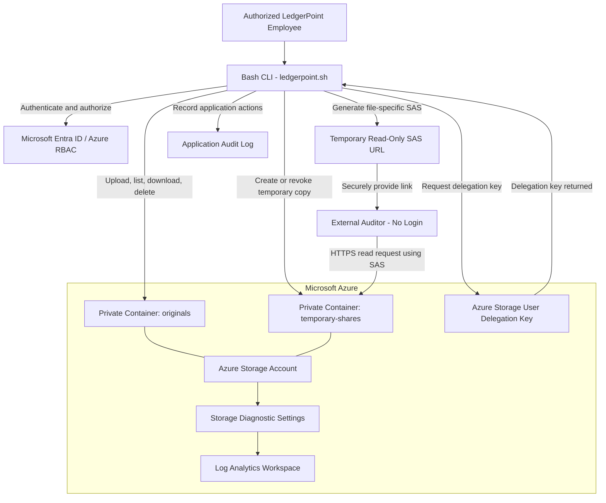

# LedgerPoint — Secure Cloud File Storage Architecture
**Project:** TECHCRUSH Group 2 — Secure Cloud File Storage System
**Cloud Provider:** Microsoft Azure
**Architecture Status:** Proposed — pending final review and implementation
## 1. Architecture Overview
LedgerPoint requires a secure, affordable cloud file storage system that allows authorized employees to manage financial statements and share individual documents with external auditors without requiring auditor accounts.

The proposed solution uses Azure Blob Storage, Microsoft Entra ID, Azure RBAC, Bash, Azure CLI, user delegation SAS URLs, and audit logging.

## 2. Architecture Diagram

## 3. Component Responsibilities

| Component | Responsibility |
|---|---|
| Authorized employee | Manages confidential documents through the Bash CLI |
| Bash CLI | Handles file operations, sharing, revocation, validation, and application logging |
| Microsoft Entra ID | Authenticates employee identities |
| Azure RBAC | Grants only the permissions required for each operation |
| Azure Storage Account | Hosts private Blob containers |
| originals container | Preserves original confidential documents |
| temporary-shares container | Holds uniquely named temporary copies intended for external sharing |
| User Delegation SAS | Provides temporary, read-only authorization to a specific shared blob |
| External auditor | Retrieves the permitted document without an Azure account |
| Application audit log | Records user-initiated application actions |
| Azure diagnostics | Records supported Blob Storage operations and request outcomes |
| Log Analytics | Stores and supports investigation of Azure diagnostic events |

## 4. Document Upload Workflow

1. An authorized employee signs in to Azure.
2. The employee invokes the Bash CLI upload command.
3. The CLI validates the request and checks the operation result.
4. The document is uploaded into the private originals container.
5. The application records the upload event.
6. Azure Storage diagnostics provide additional evidence of the storage request.

## 5. Secure External Sharing Workflow

1. An employee selects a document to share.
2. The application creates a uniquely named temporary copy in the private temporary-shares container.
3. The application obtains appropriate user delegation authorization from Azure Storage.
4. A read-only, HTTPS-only SAS URL is generated for the temporary blob.
5. The default expiry is 30 minutes, with a shorter configurable test duration.
6. The application records the issuer, intended recipient, blob identifier, expiry, and result, without logging the SAS secret.
7. The employee provides the URL to the intended auditor through an approved communication channel.
8. The auditor accesses the temporary blob directly through Azure Storage.
9. Azure Storage diagnostics can provide evidence of the access request.

## 6. Expiry and Revocation

SAS access ends when its authorization expires.

For early revocation, an authorized employee invokes the application's revoke operation. The application identifies and deletes the corresponding temporary shared copy, preserving the original document.

Each share must use a unique temporary blob name so that revoking one share does not unintentionally revoke another.

Deleting a temporary shared blob does not erase copies previously downloaded by the auditor.

Expired temporary copies must also be cleaned up.

## 7. Security Controls

- Disable anonymous public Blob access.
- Keep both Blob containers private.
- Use HTTPS for storage requests and shared URLs.
- Authenticate employees using Microsoft Entra ID.
- Apply least-privilege Azure RBAC permissions.
- Prefer user delegation SAS instead of account-key-signed SAS.
- Restrict external sharing to read-only access on a specific temporary blob.
- Never commit credentials, SAS URLs, or confidential documents to Git.
- Record successful and failed actions.
- Restrict access to application and Azure diagnostic logs.
- Use synthetic financial documents during testing.

## 8. Audit Logging Design

Application logs capture operations initiated through the Bash CLI, including who requested an action, the target resource, timestamp, and result.

Azure Storage diagnostic logs capture supported storage requests and help verify whether a file was accessed through a shared link.

Application audit records require secure storage or export beyond an ordinary editable local log file for a production-ready system. The implementation and retention controls will be validated during the logging stage.

A SAS download does not independently prove the real-world identity of the person using the URL. The intended recipient must be recorded separately.

## 9. Cost and Operational Considerations

The solution will use an economical Azure Storage configuration suitable for a small demonstration workload.

Costs must be monitored for storage capacity, storage transactions, and Azure Monitor / Log Analytics ingestion and retention.

Temporary files should be removed when no longer needed.

The Bash CLI should provide simple commands and understandable error messages so non-technical staff can operate it with minimal training.

## 10. Architecture Verification Criteria

The architecture will be considered implemented and verified when:

- Both containers exist and anonymous public access is disabled.
- Authenticated employees can perform authorized operations.
- The CLI supports upload, download, list, and delete.
- A valid SAS URL permits the intended read operation without auditor login.
- An expired SAS URL is denied.
- Revoking a temporary shared copy prevents further normal retrieval through its SAS URL.
- The original document remains intact after revocation.
- Application and Azure diagnostic logs provide evidence of operations.
- Automated deployment and end-to-end tests succeed.

**Final design approval:** Pending Phase 0 review.