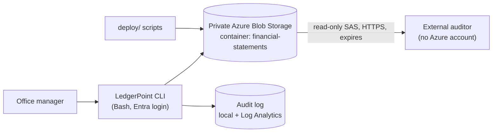
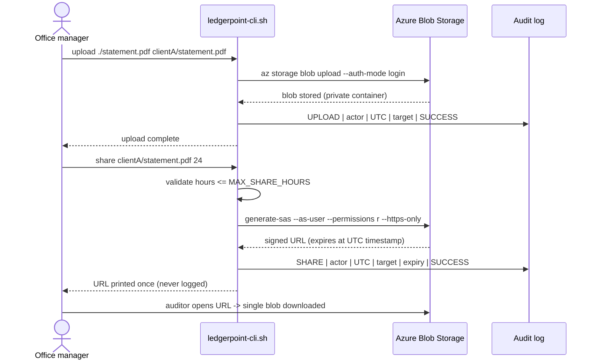
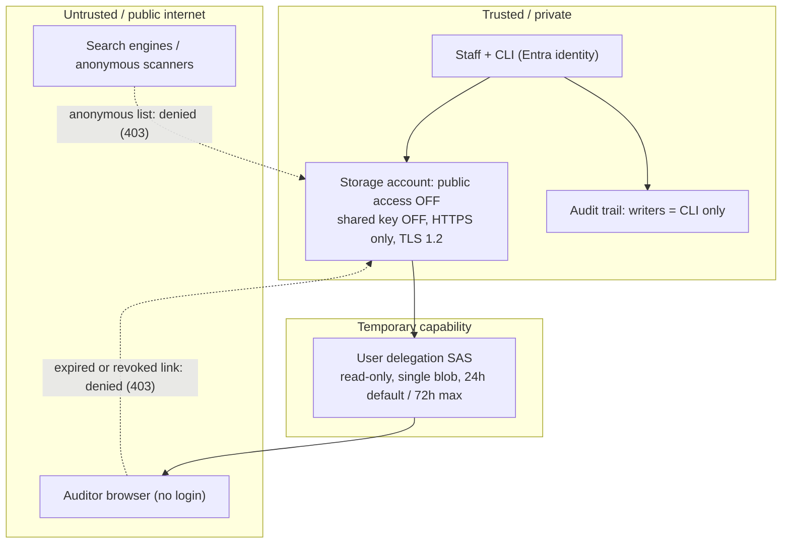

# Architecture diagrams (source)

Mermaid source for the diagrams referenced by the Phase 0 worksheet and
`docs/02-architecture/`.

## 1. System overview

## 2. Data flow (upload and share)

## 3. Trust boundary

