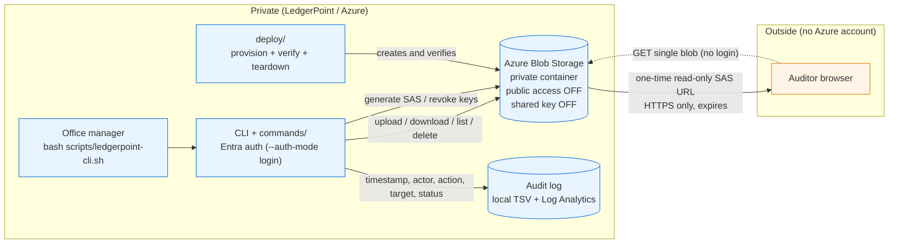

# System overview (as built)

## Components

| Component | Responsibility | Implementation |
| --- | --- | --- |
| Office manager / staff | Upload and share files | `scripts/ledgerpoint-cli.sh` |
| CLI tool | upload, download, list, delete, share, revoke | `scripts/commands/` + `scripts/` |
| Cloud storage | Private blob holding financial statements | `deploy/` |
| Share capability | Time-limited unguessable link | user delegation SAS (ADR-001) |
| Audit trail | Append-only record of actions | `audit/` + Log Analytics |
| Automation | Provision/verify/tear down | `deploy/`, `.github/workflows/` |

## Trust boundary

Storage is private. The only thing that crosses to the outside is a **single,
time-limited capability URL** for a specific object. No account, no listing, no
container-level access.

## Diagram

The source for this diagram is `../01-design/diagrams/architecture.md`.

What the diagram proves:

- the auditor never receives an account, a listing or container access;
- the SAS URL is the only object crossing the trust boundary, and it is temporary;
- every operator action is written to the audit trail before the tool exits.
